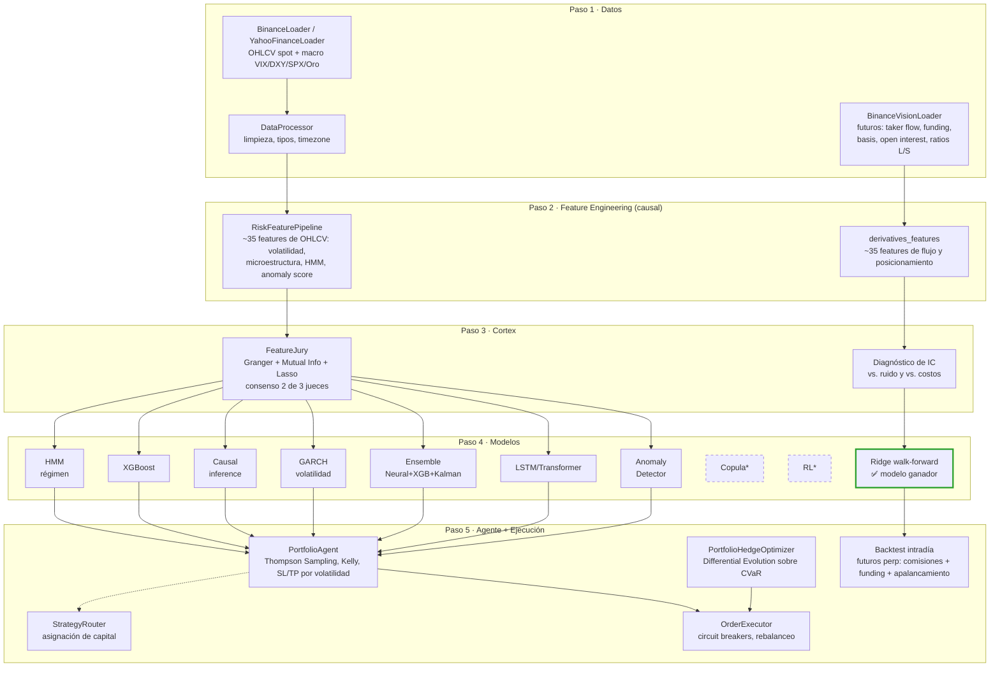
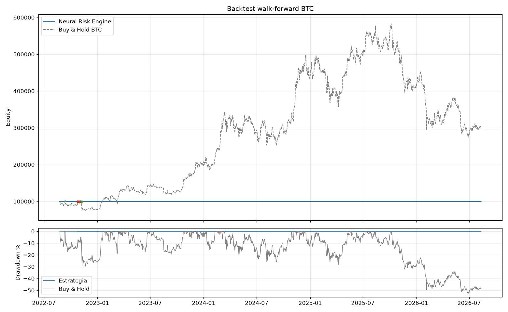
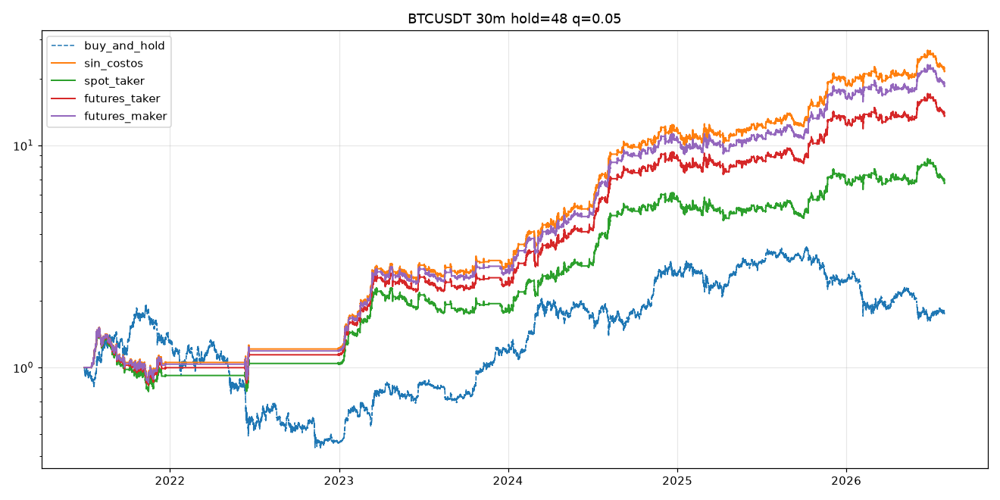

# Neural Risk Engine

Motor de trading algorítmico para cripto con dos pipelines:

1. **Motor multi-experto original** (velas diarias). Tiene 5 capas: ingesta de datos → ingeniería de features → selección estadística de features → comité de 9 modelos → agente con aprendizaje adaptativo (Thompson Sampling) y hedging a nivel portafolio. Después de auditarlo y corregirlo, **el backtest walk-forward no muestra ventaja predictiva**. Las features salen solo de velas OHLCV y no contienen información sobre el retorno futuro.
2. **Pipeline intradía de derivados** (velas de 5m a 4h). Usa datos que no están en el precio: flujo agresor real (taker), funding, basis, open interest y ratios long/short de Binance Futures, con un modelo ridge walk-forward. **Muestra ventaja fuera de muestra en BTC, ETH y SOL, neta de comisiones de Binance y funding.**

> ⚠️ Todos los resultados son backtests sobre datos históricos. No son garantía de resultados futuros ni una recomendación de inversión.

---

## Arquitectura


<sub>*Copula y RL están implementados como parte de la librería, pero no están conectados a ningún pipeline.</sub>

### Scheduling de entrenamiento del motor original (dos velocidades)

| Tier | Expertos | Frecuencia | Por qué |
|---|---|---|---|
| **Rápido** | HMM, XGBoost, Causal, GARCH, Isolation Forest | 1x/día | Modelos deterministas o de árboles, baratos de reentrenar |
| **Lento** | Ensemble neuronal, LSTM/Transformer, Autoencoder | cada 5 días | Redes con backprop, costosas de reentrenar |

El ciclo **live** (60-300s) nunca reentrena: solo predice con los modelos que dejó cacheados `train_models.py`. El jurado de features solo vuelve a elegir columnas cuando se reentrena el tier lento, así los dos tiers usan siempre exactamente las mismas.

---

## Resultados

### 1. Motor multi-experto original: sin ventaja

Backtest walk-forward sobre BTC diario, del 2022-08 al 2026-08 (1.449 barras fuera de muestra). Se reentrena cada 30 días, la entrada es en la apertura siguiente, hay SL/TP intrabarra y se cobra 0.15% por lado entre comisión y slippage.

| | Estrategia | Buy & Hold |
|---|---|---|
| Retorno total | -0.25% | +201% |
| Sharpe | -0.61 | 0.82 |
| Trades | 6 | — |
| Acierto direccional por experto | XGB 48.5% · Causal 52.0% · LSTM 48.8% · Ensemble 49.9% | — |



**Por qué no funciona.** Medí el poder predictivo de cada feature por separado: la correlación de rango (IC) con el retorno de los 5 días siguientes, contra 20 columnas de ruido aleatorio como control.

- **Solo 1 de 43 features supera el umbral de azar** (|IC| > 0.10 con ~389 observaciones independientes). Las otras 42 rinden igual o peor que el ruido.
- Las features se llaman "order book", "bid-ask", "order flow" u "opciones", pero **todas son fórmulas sobre velas OHLCV**. El sistema no tiene ninguno de esos datos.
- El jurado eligió en el 88% de los reentrenamientos una feature con IC 0.002.
- Hay ~389 observaciones independientes para entrenar redes con atención, LSTM y Transformer, así que memorizan ruido.
- El agente no pudo "premiar al experto bueno" por dos razones: Thompson Sampling solo aprende de trades cerrados (hubo 6) y ningún experto tenía ventaja.

### 2. Pipeline intradía de derivados: con ventaja

**Configuración**: velas de 30 min, ridge walk-forward (reentreno mensual, solo con datos cuyo resultado ya se conocía), se opera el 5% más extremo de la señal, se mantiene 24 horas, entrada en la apertura siguiente, posición 1x sin apalancamiento. Los costos son las comisiones de Binance Futures más el **funding real pagado o cobrado cada 8h**. El período va de 2021-06 a 2026-07 en BTC, y de 2021-12 a 2026-07 en ETH y SOL.

#### Resultado por activo (futuros taker, VIP 0)

| Activo | Retorno total | CAGR | Sharpe | Max DD | Trades | Buy & Hold |
|---|---|---|---|---|---|---|
| **BTC** | **+1.259%** | 68% | **1.60** | -45% | 386 (6/mes) | +75% (Sharpe 0.47, DD -77%) |
| **ETH** | +516% | ~48% | 1.08 | -47% | 405 (7/mes) | **-54%** |
| **SOL** | +1.244% | ~76% | 1.20 | -70% | 369 (7/mes) | **-63%** |

Los parámetros se eligieron mirando solo BTC. **ETH y SOL funcionan como prueba fuera de muestra**: nunca se usaron para ajustar nada, y la estrategia gana aunque los dos activos cayeron más del 50% en el período. Gana tanto en longs como en shorts.



#### Cuánto queda con las comisiones de Binance (BTC, 1x)

Cada trade gana en promedio **87 bps brutos** y se hacen ~74 trades por año.

| Escenario | Costo ida y vuelta | Retorno total | CAGR | Sharpe | Max DD | Costo anual aprox. |
|---|---|---|---|---|---|---|
| Sin costos (referencia) | 0% | +2.061% | — | 1.85 | -43% | — |
| Spot taker (0.10% + slippage) | 0.30% | +586% | 46% | 1.22 | -49% | ~22% |
| **Futuros taker (0.05% + 1bp)** | **0.12%** | **+1.304%** | **68%** | **1.60** | **-46%** | **~9%** |
| Futuros taker con descuento BNB | 0.11% | +1.361% | 69% | 1.63 | -46% | ~8% |
| Futuros maker (0.02%) | 0.04% | +1.830% | 79% | 1.78 | -45% | ~3% |

*Tarifas VIP 0 de Binance al momento del análisis; verificalas antes de operar. Con órdenes maker el fill no está garantizado. Esta tabla y la de modelos salen de `compare_models.py`, que normaliza el target antes de entrenar; por eso el retorno de BTC difiere levemente del de la tabla por activo (+1.304% contra +1.259%).*

**Qué lo hacía no rentable**: (1) features sin información, (2) los costos de spot, que se comen un tercio de la ventaja, y (3) tenencias cortas. Con tenencia de 1 hora el Sharpe es **negativo en todos los timeframes**, porque la ventaja por trade (~8 bps) es menor que el costo (12 bps). La señal se puede calcular cada 5, 15 o 30 min, pero **la posición tiene que durar 12-24 h**.

#### Robustez: no depende de un solo parámetro

Sharpe con futuros taker en BTC, según el timeframe de la señal y la tenencia:

| Timeframe \ tenencia | 1 h | 4 h | 12 h | 24 h |
|---|---|---|---|---|
| 5m | -1.07 | 0.92 | 1.32 | 1.55 |
| 15m | -1.05 | 0.79 | 1.32 | 1.42 |
| 30m | -0.22 | 0.92 | 1.25 | 1.54 |
| 1h | 0.19 | 0.62 | 0.93 | 1.29 |
| 4h | — | 0.52 | 0.74 | 0.84 |

*(Umbral del 2% más extremo. La grilla completa, con 4 umbrales y 3 escenarios de costos, se genera con `scripts/intraday_grid.py`.)*

#### Apalancamiento: no mejora la estrategia, solo multiplica el riesgo

| BTC, futuros taker | 1x | 2x | 3x | 5x |
|---|---|---|---|---|
| Sharpe | 1.60 | 1.60 | 1.60 | 1.60 |
| Max drawdown | -46% | -73% | -89% | **-99%** |

Hay trades individuales de -17% (BTC) a -26% (SOL) a 1x. A 5x, uno solo de esos trades liquida la cuenta. **Se recomienda 1x o menos.** Por ejemplo, con 0.5x el drawdown queda en ~-25%.

#### Qué modelo funciona mejor (BTC, futuros taker, 1x)

Todos usan las mismas features, el mismo target y el mismo walk-forward.

| Modelo | IC fuera de muestra | Sharpe | Retorno total |
|---|---|---|---|
| **Ridge (lineal)** | **0.072** | **1.60** | **+1.304%** |
| Solo `crowd_ls` (ratio long/short del público) | 0.038 | 1.09 | +428% |
| Ensemble 80% ridge / 20% XGB | 0.058 | 1.05 | +359% |
| Ensemble 60% ridge / 30% XGB / 10% MLP | 0.060 | 1.01 | +333% |
| Ensemble 70% ridge / 20% XGB / 10% MLP | 0.061 | 0.93 | +275% |
| Ensemble con pesos iguales | 0.061 | 0.75 | +175% |
| XGBoost | 0.053 | 0.57 | +100% |
| Red neuronal (MLP) | 0.037 | 0.47 | +74% |
| Ensemble adaptativo (pesos según el IC de los 180 días previos) | 0.055 | 0.36 | +40% |

Lo mismo se repite en los tres activos (Sharpe con futuros taker, 1x):

| Modelo | BTC | ETH | SOL |
|---|---|---|---|
| **Ridge solo** | **1.60** | **1.08** | **1.17** |
| 80% ridge / 20% XGB | 1.05 | 0.94 | 0.90 |
| 70% ridge / 20% XGB / 10% MLP | 0.93 | 0.73 | 0.71 |
| Pesos iguales | 0.75 | 1.04 | 0.63 |
| Adaptativo por IC | 0.36 | 0.81 | 0.64 |
| XGBoost | 0.57 | 0.39 | 0.24 |
| MLP | 0.47 | -0.28 | -0.06 |

**Cuanto más peso tiene ridge, mejor da la combinación, y el óptimo es ridge solo.** XGBoost y la red neuronal no aportan información que ridge no tenga; solo agregan ruido de sobreajuste. Con esta relación señal/ruido, el modelo más simple gana. Los pesos adaptativos asignaron en promedio 38% / 30% / 32%: en una ventana de 180 días el IC de los tres modelos se parece, pero las predicciones extremas de ridge (las que se operan) son mejores.

**De dónde viene la ventaja**: de los datos de posicionamiento (ratios long/short de top traders y del público, funding, basis, open interest). Lo que más aporta es operar contra el lado sobrecargado del mercado.

#### Limitaciones conocidas

- **El retorno está concentrado en 2023-2024.** En 2021-2022 el resultado fue de -22% a +35% según el activo. En los últimos 12 meses: BTC +44%, SOL +8%, **ETH -2%**. La ventaja puede estar achicándose.
- **Un drawdown de -45% a 1x es alto.** Conviene dimensionar la posición según la volatilidad en vez de usar siempre el 100% del capital.
- El backtest no modela fills parciales de órdenes maker, slippage real en activos menos líquidos (SOL) ni impacto de mercado con capital grande.
- Falta validación en vivo: el siguiente paso es paper trading en el testnet de Binance Futures.

---

## Ingeniería y debugging destacado

El proyecto pasó por una auditoría completa. Los bugs más importantes se confirmaron **ejecutando** el código, no solo leyéndolo:

- **Expertos que fallaban en todos los ciclos sin que nada avisara.** El ensemble le pasaba a XGBoost una ventana aplanada (`Feature shape mismatch, expected 6, got 60`), y GARCH llamaba `.values` sobre un ndarray. Como los dos estaban envueltos en `try/except` que devolvían 0, el smoke test "pasaba" igual.
- **Look-ahead en las features.** IsolationForest, KMeans y HMM se ajustaban sobre la serie completa, y el HMM devolvía probabilidades *smoothed*, que usan observaciones futuras. Ahora se ajustan por bloques, solo con datos pasados, y el HMM usa probabilidades *filtradas*. También se eliminó un `bfill()` que rellenaba con valores futuros, y un desfase de 5 min en el premium index.
- **Triple barrier mal etiquetado.** No miraba qué barrera se tocaba primero: un camino que tocaba el stop y después el profit quedaba como ganador.
- **Target asimétrico usado para decidir dirección.** Con barreras de +2σ y -1σ, un "-1" significa que un long habría tocado el stop, no que un short gana. El sistema terminaba "shorteando" por un sesgo de la etiqueta.
- **Kelly se bloqueaba solo.** Un trade perdedor dejaba el sizing en 0, sin trades no hay feedback nuevo, y el agente quedaba bloqueado para siempre. Se corrigió con shrinkage hacia un prior y un tamaño mínimo.
- **La equity del backtest contaba el capital dos veces** (`portfolio_value + cash`): el gráfico mostraba un +100% falso.
- **Tiers desincronizados.** El reentreno rápido pisaba las features elegidas mientras los modelos lentos seguían entrenados con otras columnas.
- **Backtest inviable por tiempo de cómputo** (27s de features por barra, ~27 h por corrida). Con el pipeline causal las features se calculan una sola vez y la corrida baja a minutos.
- Antes de la auditoría: look-ahead en `synthetic_delta` (`shift(-1)`), circuit breaker de pérdida diaria muerto, error en Kelly con señales negativas, reentrenamiento de los 9 modelos en cada ciclo de 60s, e imports ansiosos de todo el paquete.

## Stack técnico

`Python` · `PyTorch` · `XGBoost` · `scikit-learn` · `hmmlearn` · `arch (GARCH)` · `statsmodels` · `SQLite` · `ccxt` (Binance) · `data.binance.vision` · `scipy.optimize` (Differential Evolution) · `matplotlib`

## Cómo correrlo

```bash
pip install -r requirements.txt

# --- Pipeline intradía de derivados ---
# 1) Descargar datos de futuros de Binance (caché local en data/binance_vision/, ~150 MB por símbolo)
python -c "from neural_risk.data.binance_vision import BinanceVisionLoader as L; l=L(); \
  l.klines('BTCUSDT','5m','2021-01','2026-07'); l.premium_index('BTCUSDT','5m','2021-01','2026-07'); \
  l.funding_rate('BTCUSDT','2021-01','2026-07'); l.metrics('BTCUSDT','2021-01-01','2026-08-10')"
#    (los scripts esperan data/binance_vision/{SYMBOL}_{klines_5m,premium_5m,funding,metrics_5m}.pkl)

# 2) Diagnóstico de señal: IC por feature vs. ruido y vs. costos
python scripts/feature_diagnostics.py --symbol BTCUSDT --timeframes 15m 1h 4h

# 3) Backtest con comisiones de Binance + funding
python scripts/backtest_intraday.py --symbol BTCUSDT --timeframe 30m --hold 48 --q 0.05

# 4) Robustez (timeframe x tenencia x umbral) y comparación de modelos / comisiones / apalancamiento
python scripts/intraday_grid.py --symbol BTCUSDT --timeframes 5m 15m 30m 1h 4h
python scripts/compare_models.py --symbol BTCUSDT --timeframe 30m --hold-hours 24 --q 0.05 --leverages 1 2 3 5

# --- Motor multi-experto original ---
python scripts/backtest.py --asset BTC --data "data/raw/BTC_UST Binance Historical Daily Data.csv"

# Sistema en vivo del motor original (4 procesos, comunicados por SQLite)
python scripts/run_data_fetcher.py    # Layer 1: ingesta
python scripts/train_models.py        # Layer 2: entrenamiento por tiers
python scripts/run_engine.py          # Layer 3-5: predicción + decisión
python scripts/run_executor.py        # Layer 6: ejecución + circuit breakers
python scripts/run_portfolio_hedge.py # Hedging a nivel portafolio (asesor)
```

Los resultados se guardan en `backtest_results/`: equity, trades, métricas y gráficos.

## Estado del proyecto

- ✅ Motor original auditado, corregido y ejecutable de punta a punta (sin ventaja predictiva sobre datos OHLCV diarios).
- ✅ Pipeline intradía de derivados con ventaja fuera de muestra en 3 activos, neta de costos.
- ⏳ Pendiente: paper trading en el testnet de Binance Futures, dimensionamiento de la posición según la volatilidad, y conectar la señal ridge al executor live.

Ver [`STATUS.md`](STATUS.md) para el historial de la auditoría.
